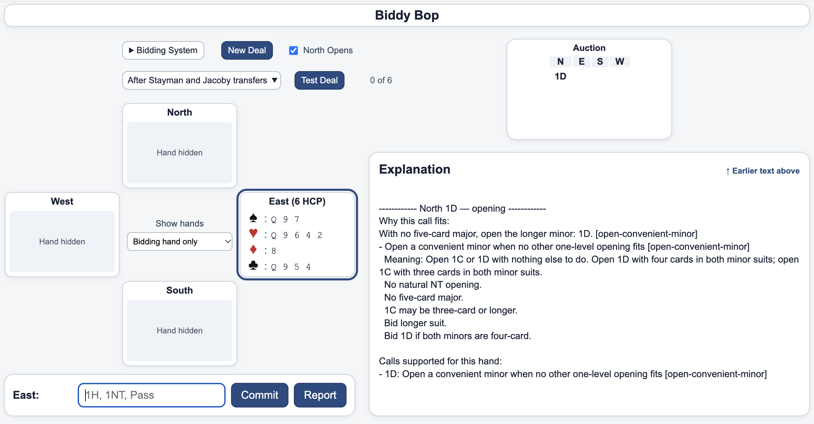

# Bridge Bidding Trainer

BiddyBop is a practice app for learning and practicing contract bridge bidding.
It teaches a practical blend of SAYC-based Standard American bidding and widely used modern
treatments (such as splinters and invitational 2NT responses to minor openings), with a small
number of fixed teaching simplifications (such as requiring exactly six cards for weak-two
openings). It is neither strict SAYC (for example, it uses DONT against opposing strong 1NT
openings) nor a complete modern 2/1 system (2/1 game forcing is optional, and inverted minor
raises are not taught).

The bidding approach draws on the ACBL SAYC booklet and teaching materials by Larry Cohen,
Audrey Grant, and Karen Walker, without attempting to reproduce any one of their complete
systems. BiddyBop focuses on common bidding decisions it can explain reliably and makes clear
where partnership agreements or bridge judgment matter more than fixed rules.

## Try it

Run the web version directly in your browser:

[Open Bridge Bidding Trainer](YOUR_GITHUB_PAGES_URL)

No installation is required for the web version.

## Using the app

Start a new deal or select a prepared practice exercise.  Enter every call for every seat,
including Passes.  Although the
app displays the hands, make each decision using only the current player's cards, the
auction, and the selected partnership agreements.  Be careful to use only what you know from the 
bidding and don't enhance bids based on seeing other hands.  This gives you more practice with 
feedback than making one or two bids per deal.

For New Deal, North always deals first.  The **Give North an opening hand** checkbox
is enabled by default; turn it off for a completely random deal with North still the dealer.
The **Show hands** selector normally reveals only the hand currently bidding; choose
**All hands always** to examine the complete deal.

The explanation area shows why bids qualify under the supported bidding rules and, where appropriate, which alternatives have higher priority.  Bridge does not always have one absolutely correct bid, so the app shows all that apply.

Use the rule-practice deal selector to focus on a particular bidding situation instead of
receiving a random deal.  These deals illustrate specific rules, nearby strength boundaries (or a ladder of bids based on partner's bid and points or structure of your hand), and differences between partnership agreements.

In a selected practice deal, if you enter a different bid, the explanation still evaluates your
choice, but the recorded bid is used to keep the remaining lesson on track.  The recorded bid
is not necessarily the only reasonable choice. Each exercise stops at its intended final call,
which need not be the end of the bridge auction.

The app is a practice companion: make a bidding decision first, then compare it with the
supported candidates and explanations.  It does not claim to know the best bid in every auction.

## Bidding-system agreements

BiddyBop teaches one selected partnership system, with some assumptions fixed and a smaller
set of agreements configurable in **Bidding System**. The fixed assumptions describe what
the app teaches; they are not switches that can be changed by editing a setting.

### Fixed bidding agreements and teaching assumptions

- **One-level suit openings:** Five-card majors and convenient minors. With both minors, open
  the longer; with equal four-card minors, open 1D; with equal three-card minors, open 1C.
  Ordinary openings generally require at least 12 total points with length, subject to
  the opening rules' HCP, shape, and Guideline of 20 qualifications.
- **Strong openings:** An artificial strong 2C requires 22+ HCP (without a separate
  playing-trick exception); a natural 2NT opening shows 20–21 HCP and appropriate shape.
- **Preemptive openings:** Weak 2D/2H/2S openings require exactly six cards and 5–11 HCP.
  Three-level preempts require seven cards and at most 11 total points with length. These
  fixed cutoffs are teaching simplifications, not universal bidding requirements.
- **Responses to one-level suit openings:** Ordinary responses start at six points with
  the relevant hand valuation; natural new-suit responses require at least four cards and
  are generally forcing for one round. Under Standard responses, a natural two-level new
  suit generally requires 11+ points. Responses to convenient-minor openings favor
  four-card majors up the line and, with suitable longer suits, five-card suits down the line.
  The chosen treatments also include natural invitational 2NT and game-going 3NT responses
  to minor openings rather than inverted minor raises.
- **Hand valuation:** Length points supplement HCP for ordinary total-point evaluation;
  shortage points supplement HCP when evaluating support for partner's suit. The relevant
  measure depends on the bidding situation.
- **Selected conventions and competitive treatments:** Jordan 2NT after a takeout Double
  of partner's one-level suit opening, strength-showing Redouble, and a compact **DONT**
  defense against an opposing strong 1NT are fixed treatments. DONT is on, not a settings
  option; it includes basic pass-or-correct continuations but not all DONT extensions.
- **Slam-related calls:** Gerber 4C after a notrump opening and Blackwood 4NT after a suit
  auction are selected ace-asking treatments; direct 4NT over a natural notrump opening
  is quantitative rather than Blackwood. The app does not teach a complete slam system
  or all conventional ace-asking responses.

These are summaries, not a complete rule specification. The bidding-coverage tables below
identify which auction families and later continuations are supported or omitted.

### Configurable partnership agreements

| Setting | Available choices | Default |
| --- | --- | --- |
| 1NT opening range | 15–17 or 16–18 HCP | 15–17 |
| Five-card-major 1NT upgrade | On or off (upgrade a qualifying balanced hand one HCP below the normal range) | Off |
| Jump shifts after a one-level suit opening | Strong or weak | Strong |
| Two-level new-suit responses | Standard or 2/1 game forcing | Standard |
| 1NT response to partner's major | Forcing or non-forcing | Non-forcing |
| Major game force with support | New suit then raise or Jacoby 2NT | New suit then raise |
| Stayman | On or off | On |
| Jacoby transfers | On or off | On |
| Splinters | On or off | On |
| Texas transfers | On or off | On |

Changing an agreement can change both the recommended bids and which prepared rule-practice
deals are available. Some practice groups may have no compatible deals under particular settings.

## What the app is and isn't

Bridge bidding combines rules, partnership agreements, inference, and judgment.  Suit quality,
borderline strength, distribution, vulnerability, and partnership style can all affect the best
call.  The app concentrates on common situations that can be taught consistently as rules,
but it does not attempt to be a complete expert bridge bidding app for teaching.

Where judgment matters more than an absolute rule, the app may provide guidance or show
multiple reasonable calls, without declaring one uniquely correct.  For example, it includes
some slam-related decisions without teaching a complete slam-investigation system.  After some 
very strong openings, competitive auctions, or artificial bids, the app explains the limits
of its bidding feedback and suggests aspects of judgment to consider rather than enable practice for
which the app can't reliably give feedback.

## Bidding coverage

The tables describe the bidding treatments the app teaches. `Done` means the selected
treatment is supported; `Partial (done)` means a deliberately limited but useful subset is
supported; and `Omitted` means that auction family is outside the chosen support this app provides.

For awkward natural rebids, the app sometimes teaches a constrained fallback (a two-card
`2C` after forcing `1NT` to a major, or a five-card minor repeat after a forcing one-level
new-suit response). Very strong long-minor hands without a reliable normal rebid instead receive
judgment guidance; point limits on invitational bids are not automatically relaxed. A balanced
11-HCP hand does not qualify for an opening of a convenient minor on length points alone.

### When our partnership opens

| Our opening | Ordinary response | Response after interference | Uncontested opener rebid | Opener rebid after interference |
| --- | --- | --- | --- | --- |
| 1C / 1D | Done | Done: selected common interference | Done | Partial (done): selected competitive continuations |
| 1H / 1S | Done | Done: selected common interference | Done | Partial (done): selected competitive continuations |
| 1NT | Done | Partial (done): natural two-level suit interference | Done | Partial (done): selected Double, natural suit, and NT continuations |
| 2NT | Done | Omitted | Partial (done): selected continuations | Omitted |
| Strong 2C | Done | Omitted | Partial (done): selected continuations | Omitted |
| Weak 2D / 2H / 2S | Done | Omitted | Partial (done): selected continuations | Omitted |
| Three-level preempt | Partial (done): selected responses | Omitted | Partial (done): selected continuations | Omitted |
| Natural four-/five-level preempt | Partial (done): Pass only | Omitted | Omitted | Omitted |

The omitted responses after interference are intentional limits of the app. Once opponents
interfere, further bidding can require different partnership agreements, more judgment, and
complicated decisions with less bidding room. The app provides general guidance in some of
these situations, even when it cannot recommend a specific bid. The reasons for these
omissions are explained below.

**After a 2NT opening**, some partnerships may keep familiar conventions available after a Double,
but Pass and Redouble acquire different meanings and suit interference quickly becomes
space-sensitive and agreement-dependent.  That creates a relatively large competitive branch for
an uncommon auction, so the app stops rather than teaching only a fragment of a 2NT
interference system.

**After a strong 2C opening**, some normal calls can remain sensible after a Double, including a
waiting response under common methods.  But the opening is already rare and artificial, competitive
meanings vary by partnership, and a separate interference system adds little practice value for the
amount of branching it introduces.  The app therefore keeps this family uncontested.

**After a weak-two opening**, several ordinary continuations can still make bridge sense after
interference, and this is the most plausible of these omitted families to reconsider later.  Still,
Pass into a doubled contract is no longer the same decision, suit overcalls create different
constraints from a Double, and a useful treatment would need more than simply reusing every
uncontested rule.  For now the app stops rather than presenting an incomplete competitive
system.

**After a three-level preempt**, the auction is already high enough that available space, fit,
playing strength, vulnerability, and judgment become important quickly.  The frequency and training
value do not justify another high-level competitive continuation tree, so responder interference is
intentionally omitted.

Many responder rebids are covered, but the app stops trying to cover all bids due to judgment or partnership agreements becoming more important than clear-cut rules.

### When the opponents open

| Opponent's opening | Our direct defense | Advancer after responder passes | Advancer after responder acts | Overcaller continuation |
| --- | --- | --- | --- | --- |
| 1C / 1D / 1H / 1S | Done | Done | Partial (done): selected common actions | Partial (done): selected natural suit, 1NT, and takeout-Doubler rebids |
| Strong 1NT | Partial (done): core DONT defense | Done: basic responses to DONT | Omitted | Done: basic DONT pass-or-correct follow-ups |
| Weak 2D / 2H / 2S | Done | Partial (done): selected common continuations | Omitted | Partial (done): selected natural suit, 2NT, and takeout-Double continuations |
| Three-level preempt | Omitted | Omitted | Omitted | Omitted |
| Strong 2C / 2NT | Omitted | Omitted | Omitted | Omitted |

Against a strong 1NT opening, the app teaches the basic compact DONT interference but stops before
later competitive continuations.  Double shows a good six-card-or-longer club, diamond, or heart suit;
2C shows clubs and a higher suit, 2D shows diamonds and a major, 2H shows both majors,
and 2S naturally shows a long spade suit.  Advancer's basic relay and pass-or-correct
responses are supported.

**The app omits these three optional DONT extensions:**

- **A 2NT game inquiry:** going beyond finding a playable suit to investigate game adds
  extra partnership-specific responses and judgments.
- **A stronger spade hand shown by Double followed by 2S:** some full DONT methods use
  this delayed route to distinguish strong spades from a direct 2S.  Our compact version
  uses direct 2S for the one-suited spade hand without that extra strength distinction.
- **Continuations after the 1NT responder competes:** once responder bids or
  Doubles, simple pass-or-correct sequences may no longer apply, and further calls
  require additional competitive agreements.

We deliberately omitted these more elaborate and judgment-heavy continuations
so the chosen DONT treatment remains compact and teachable.  These omissions do
not change the meanings of the supported DONT calls.  In an unmodeled continuation,
the app gives guidance rather than inventing a conventional call or
treating an unsupported Pass as necessarily wrong.

Weak-two defenses include
selected advances, natural Pass decisions, and immediate responses to forcing or conventional calls.
They do not include full competition after responder bids, continuations after natural three-level
overcalls, or a general system for repeated high-level bidding.  Defenses against opposing
three-level preempts, strong 2C/2NT, and higher openings remain omitted.  The app explains where it
stops reviewing bids and giving feedback due nuances and judgment and tries to provide general
continuation guidance rather than automatically recommending Pass.

### Advancer when responder acts after a one-level suit opening

| Partner's intervention | Responder passes | Responder raises opener | Responder bids a new suit / NT | Responder Doubles / Redoubles |
| --- | --- | --- | --- | --- |
| One-level natural suit overcall | Done | Partial (done): actions after simple raises; Pass or guidance after weak jump raises | Partial (done): natural suits and selected NT | Done |
| Two-level natural suit overcall | Done | Partial (done): actions after simple raises; Pass or guidance after weak jump raises | Partial (done): natural new suit and selected NT | Partial (done): where the negative Double treatment applies |
| Takeout Double | Done | Partial (done): actions after simple raises; Pass or guidance after weak jump raises | Partial (done): natural suits/NT; Pass after weak jump shifts | Done |
| Natural 1NT overcall | Done: normal 1NT systems | Partial (done): natural two-level suit interference | Partial (done): natural two-level suit interference | Omitted |
| Preemptive jump overcall | Done | Omitted | Omitted | Omitted |

This table shows the app's selected advances (after advancer's partner overcalled opener).  The app
cannot teach every possible competitive auction.  Specialized Doubles and cuebids, broader
continuations after preemptive jump overcalls, and high-level competition depend too heavily on
partnership agreements, fit, vulnerability, and playing strength for reliable rule-based advice.
Where useful, the app provides auction-specific general guidance on how bidding might procede,
rather than presenting an authoritative treatment.

## Rule-practice deals

The app includes specifically constructed deals for practicing bidding rules and important 
boundary cases.  Every prepared practice exercise starts with North as dealer. 

The practice corpus is selective rather than exhaustive.  Its purpose is to exercise meaningful bidding decisions and partnership-agreement differences, not to generate every possible permutation of every rule.

## Feedback

The explanation pane scrolls to the beginning of the latest explained call and indicates
when earlier or later text is outside the viewport. It retains up to 1,200 lines for the
current deal and resets for each new deal. If a suggested bid seems wrong, incomplete,
or poorly explained, click **Report** to copy the current deal, bidding agreements,
auction, explanations (including rule IDs), and up to 400 recent telemetry lines to the
clipboard. Telemetry is included in Report rather than displayed in the interface.

