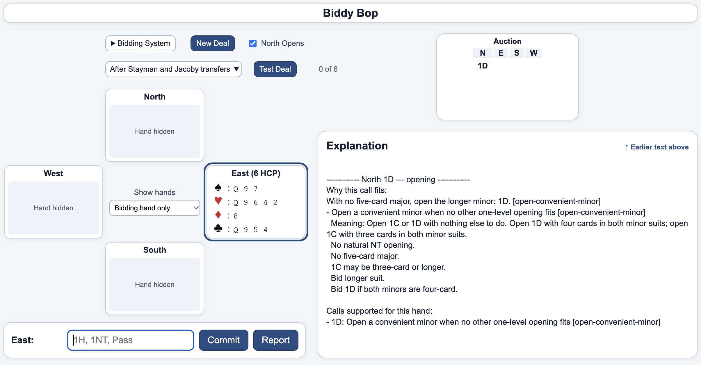

# Bridge Bidding Trainer

BiddyBop is a contract bridge bidding trainer. Work through random deals or prepared
practice exercises, choose calls for all four seats, and learn why particular bids do or
do not fit the hand and partnership agreements. The app teaches common decisions it can
explain reliably, not an automatic best bid for every auction.

Its system blends SAYC-based Standard American with selected modern treatments (such
as splinters and invitational 2NT responses to minor openings) and a few fixed teaching
simplifications. It is neither strict SAYC nor a complete 2/1 system. The approach draws
on the ACBL SAYC booklet and teaching materials by Larry Cohen, Audrey Grant, and Karen
Walker, without reproducing any one complete system.

## Try it

Run the web version directly in your browser:

[Open Bridge Bidding Trainer](YOUR_GITHUB_PAGES_URL)

No installation is required for the web version.

## Using the app

Choose **New Deal** for a generated deal or select a practice topic and click **Test Deal**
for a prepared exercise. Enter each call, including Pass, for all four seats. Decide using
only the current bidder's hand, the auction, and the selected agreements—even when you
can see other hands. Read the explanations to see which calls fit, why they qualify, and
which alternatives the app recognizes or prefers. Several bids may be reasonable.

North deals first in **New Deal**. The **North Opens** checkbox is on by default, giving
North a hand that qualifies for an opening; turn it off for a completely random deal.
The **Show hands** selector defaults to **Bidding hand only**; select **All hands always**
when you want to inspect the entire deal.

A **Test Deal** follows a recorded teaching auction. If you choose another call, the app
explains that choice but uses the recorded call to continue the lesson. The recorded call
is not necessarily the only reasonable choice. A lesson ends at its intended last call,
which may be well before the end of a complete bridge auction.

## Bidding-system agreements

The default system uses five-card majors, convenient minors, 15–17 HCP for a 1NT
opening, and Standard new-suit responses. Against an opposing strong 1NT, the default
defense is natural two-level suit overcalls; **DONT (Disturb Opponents’ No Trump)** is
optional. Some agreements are fixed teaching choices, while others can be changed in
**Bidding System**. The same selected agreements apply to all four seats.

### Fixed bidding agreements and teaching assumptions

- **One-level openings:** Five-card majors and convenient minors. With both minors, open
  the longer; with equal four-card minors open 1D, and with equal three-card minors
  open 1C. Ordinary openings generally require at least 12 total points with length,
  subject to additional HCP, shape, and Guideline of 20 qualifications.
- **Strong openings:** Artificial strong 2C requires 22+ HCP without a playing-trick
  exception. Natural 2NT shows 20–21 HCP with appropriate shape.
- **Preempts:** Weak 2D/2H/2S require exactly six cards and 5–11 HCP; three-level
  preempts require seven cards and at most 11 total points with length. These are
  teaching cutoffs rather than universal bridge requirements.
- **Responses to one-level openings:** Ordinary responses generally start at six
  points using the appropriate valuation. Natural new suits generally need at least
  four cards and force one round. Standard two-level new-suit responses usually
  require 11+ points. Minor-opening responses favor four-card majors and allow
  natural invitational 2NT and game-going 3NT responses rather than inverted minors.
- **Hand valuation:** HCP may be supplemented by length points for ordinary bidding
  or shortage points when supporting partner's suit.
- **Competitive treatments:** Jordan 2NT after a takeout Double of partner's
  one-level opening and a strength-showing Redouble are fixed treatments.
- **Slam-related calls:** Selected Gerber, Blackwood, and quantitative 4NT meanings
  are taught, but not a complete slam system or all ace-asking responses.

These are summaries. The [specification](docs/spec.md) records the exact agreements
and exceptions, and the tables below outline where the app provides guidance.

### Configurable partnership agreements

| Setting | Available choices | Default |
| --- | --- | --- |
| 1NT opening range | 15–17 or 16–18 HCP | 15–17 |
| Five-card-major 1NT upgrade | On or off (upgrade a qualifying balanced hand one HCP below the normal range) | Off |
| Jump shifts after a one-level suit opening | Strong or weak | Strong |
| Two-level new-suit responses | Standard or 2/1 game forcing | Standard |
| 1NT response to partner's major | Forcing or non-forcing | Non-forcing |
| Major game force with support | New suit then raise or Jacoby 2NT | New suit then raise |
| Stayman | On or off | On |
| Jacoby transfers | On or off | On |
| Splinters | On or off | On |
| Texas transfers | On or off | On |
| DONT defense over an opposing strong 1NT | On (compact DONT) or off (natural 2-level suit overcalls) | Off |

Changing an agreement affects both bid guidance and available practice exercises.
Some practice topics have no compatible deals with particular settings. With 2/1 game
forcing and a non-forcing 1NT response to a major, the app uses a semi-forcing 1NT
response: opener may Pass.

## What the app is and isn't

Bidding depends on agreements and judgment as well as rules. BiddyBop covers a
selected range of openings, responses, rebids, overcalls, advances, and competitive
actions. It explains qualifying bids and some plausible alternatives, but does not
model vulnerability or scoring, cover every competitive continuation, or teach a
complete slam system.

When a decision goes beyond its selected rules, the app may provide guidance about
what to consider instead of recommending a specific call. **If no bid qualifies,
that does not mean you should Pass.** An unmodeled bid is not necessarily wrong.

## Bidding coverage

The following tables provide a more detailed view. **Done** means the selected
treatment is supported, **Partial (done)** means only a deliberate subset is taught,
and **Omitted** means it is outside the app's supported scope. A completed treatment
is not a claim to cover every possible bridge judgment.

### When our partnership opens

| Our opening | Ordinary response | Response after interference | Uncontested opener rebid | Opener rebid after interference |
| --- | --- | --- | --- | --- |
| 1C / 1D | Done | Done: selected common interference | Done | Partial (done): selected competitive continuations |
| 1H / 1S | Done | Done: selected common interference | Done | Partial (done): selected competitive continuations |
| 1NT | Done | Partial (done): natural two-level suit interference | Done | Partial (done): selected Double, natural suit, and NT continuations |
| 2NT | Done | Omitted | Partial (done): selected continuations | Omitted |
| Strong 2C | Done | Omitted | Partial (done): selected continuations | Omitted |
| Weak 2D / 2H / 2S | Done | Omitted | Partial (done): selected continuations | Omitted |
| Three-level preempt | Partial (done): selected responses | Omitted | Partial (done): selected continuations | Omitted |
| Natural four-/five-level preempt | Partial (done): Pass only | Omitted | Omitted | Omitted |

Competition after our 2NT, strong 2C, weak-two, and three-level preempt openings is
intentionally limited. Many such continuations require specialized partnership
agreements or higher-level judgment; the app avoids recommending a bid it cannot
reliably justify. Selected responder rebids and slam-related actions have similar
boundaries.

### When the opponents open

| Opponent's opening | Our direct defense | Advancer after responder passes | Advancer after responder acts | Overcaller continuation |
| --- | --- | --- | --- | --- |
| 1C / 1D / 1H / 1S | Done | Done | Partial (done): selected common actions | Partial (done): selected natural suit, 1NT, and takeout-Doubler rebids |
| Strong 1NT | Natural 2-level suits (default) or compact DONT | Selected natural advances or DONT pass-or-correct | Selected advances after negative Double/natural response (DONT off) | Selected nonforcing rebids; further competition bounded |
| Weak 2D / 2H / 2S | Done | Partial (done): selected common continuations | Omitted | Partial (done): selected natural suit, 2NT, and takeout-Double continuations |
| Three-level preempt | Omitted | Omitted | Omitted | Omitted |
| Strong 2C / 2NT | Omitted | Omitted | Omitted | Omitted |

Against an opposing strong 1NT, **natural defense is the default**: 2C, 2D, 2H,
and 2S show sound six-card-or-longer suits with at least 7 HCP. Selected Passes,
competitive raises, independent new-suit advances, and later continuations are
supported. The opening 1NT partnership also has selected natural responses, negative
Doubles, and opener rebids.

With **DONT enabled**, Double shows a long club, diamond, or heart suit; 2C
shows clubs and a higher suit, 2D diamonds and a major, 2H both majors, and 2S
a long spade suit. Basic relays and pass-or-correct actions are supported. The
compact treatment omits a 2NT game inquiry, a delayed strong-spade distinction,
and general DONT pass-or-correct continuations after the 1NT responder competes.

Other modeled defenses include selected actions against one-level suit openings
and weak-two openings. High-level competition, specialized Doubles, and further
forcing continuations may reach judgment boundaries instead of automatic bids.

### Advancer when responder acts after a one-level suit opening

| Partner's intervention | Responder passes | Responder raises opener | Responder bids a new suit / NT | Responder Doubles / Redoubles |
| --- | --- | --- | --- | --- |
| One-level natural suit overcall | Done | Partial (done): actions after simple raises; Pass or guidance after weak jump raises | Partial (done): natural suits and selected NT | Done |
| Two-level natural suit overcall | Done | Partial (done): actions after simple raises; Pass or guidance after weak jump raises | Partial (done): natural new suit and selected NT | Partial (done): where the negative Double treatment applies |
| Takeout Double | Done | Partial (done): actions after simple raises; Pass or guidance after weak jump raises | Partial (done): natural suits/NT; Pass after weak jump shifts | Done |
| Natural 1NT overcall | Done: normal 1NT systems | Partial (done): natural two-level suit interference | Partial (done): natural two-level suit interference | Omitted |
| Preemptive jump overcall | Done | Omitted | Omitted | Omitted |

The table covers selected advances after partner intervenes over a one-level suit
opening. Not every continuation is modeled; the app may provide judgment guidance
rather than an automatic bid.

## Rule-practice deals

Prepared deals focus on particular rules, nearby strength boundaries, and contrasting
partnership agreements. They use complete four-hand deals, with North as dealer.
The collection is selective rather than an exhaustive list of bidding permutations.

## Feedback

The explanation pane keeps the current deal's recent bidding feedback and scrolls to
the latest reviewed call. Click **Report** to copy the deal, four hands, selected
agreements, auction, and explanation transcript (including rule IDs) to the clipboard.
**Command-click Report** to include recent diagnostic telemetry as well.
